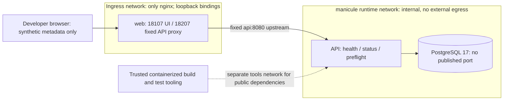

# Architecture

## Phase 1 runtime and trust boundaries

The diagram shows host port mappings and logical services, not duplicate containers.
Runtime services are `web`, `api`, and `db`. API and DB attach only to the private
internal network; nginx additionally joins the ingress network and publishes both loopback
ports. Docker Desktop 29.4.1 did not actually publish ports for internal-only containers
even though `HostConfig.PortBindings` declared them. This observed failure motivated the
fixed-upstream ingress gateway, not an unrestricted backend egress exception. Tooling may
attach to the runtime network for tests and a separate outbound-capable network for public
package retrieval. No Docker socket, privileged container, or host filesystem beyond this
project is exposed to the application.

## Components

- **Web:** React and TypeScript built by Vite with containerized Node 22. Static nginx
  delivery, same-origin API proxy, semantic form controls, loading/error states. No
  browser storage of data or credentials.
- **API:** Java 21 and Spring Boot 3.5, MVC, Jakarta validation, JDBC, PostgreSQL, Flyway,
  and Actuator. Typed request/response records and centralized RFC 9457-style problem
  responses. Structured JSON logs and generated request IDs; no request body logging.
- **Database:** PostgreSQL 17. Named volume scoped by Compose project. Separate
  bootstrap-admin and application secrets. The app role owns its database but cannot
  create databases or roles and is not a superuser.
- **Contracts:** OpenAPI describes only implemented endpoints. Future contracts are
  requirements, not advertised capabilities.
- **Tests:** Maven/JUnit + Spring MVC unit tests and real PostgreSQL integration tests;
  Vitest frontend tests; Playwright Chromium over the actual nginx/API/DB Compose stack.

## Data and request flow

Startup: PostgreSQL initializes the restricted app role and database on an empty volume;
Flyway applies V1; the API exposes database-aware readiness; nginx serves the dashboard.
The marker row is queried on `/api/status`, proving the API is reading migrated persistent
state rather than returning a hard-coded DB claim.

Database bootstrap uses native SQL rather than an executable bind-mounted shell script, so
Windows line endings cannot break its interpreter. Database health authenticates as the
application user and executes `SELECT 1`. A fresh-bootstrap regression check uses a
separate tmpfs-backed database, then stops/removes only that temporary container.

Preflight: browser sends JSON to nginx `/api/preflight`; nginx forwards to the API;
Jakarta validation checks the bounded fields; API responds with `persisted: false`. There
are no domain writes and no code execution. HTTP exceptions use explicit status codes.
Database failures do not become healthy default status objects.

## Migration policy

Flyway validates checksums and does not clean databases. V1 creates one
`skeleton_metadata` table with a single constrained marker row. It is additive and can
theoretically be reversed by dropping only that table, but rollback or data reset is
destructive and **must not be executed without approval**. Subsequent changes require new
migrations; never edit an already applied V1.

## Resource and lifecycle policy

Compose project name is `manicule`; no fixed global `container_name` values. Runtime
budget: API 512 MiB / 0.75 CPU, database 256 MiB / 0.50 CPU, web 96 MiB / 0.25 CPU. The
standard scripts run compilation/check/E2E tools sequentially with 1 CPU / 1 GiB limits.
Runtime image builds only package their already compiled outputs; no unbounded BuildKit
compilation or duplicate dependency installation is required. The temporary DB bootstrap
check is bounded to 384 MiB / 0.5 CPU. Only loopback web 18107 and API 18207 are published
by nginx. No direct API or database host port. Read-only app root filesystems, explicit
temporary filesystems, dropped capabilities, no-new-privileges, and PID limits are
required.

Local scripts preserve credentials and data across restarts. `stop` only stops this
project. Never prune Docker globally or delete volumes implicitly.

## Deferred architecture

Phase 2 introduces the guide's domain entities, routes, authorization and idempotency.
Phase 3 adds deterministic OpenAPI tasks and a local mock API. Phase 4 adds agent adapters
and a separately designed execution sandbox with network allowlists,
time/CPU/memory/output limits, and auditable approval gates. Redis is unnecessary until
there is short-lived shared state; Kafka requires a demonstrated asynchronous boundary.
Full OpenTelemetry traces and reliability engineering belong to Phase 5. AWS/Kubernetes
are not provisioned.
